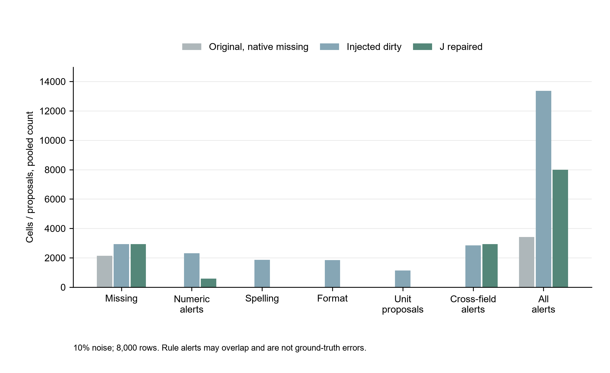
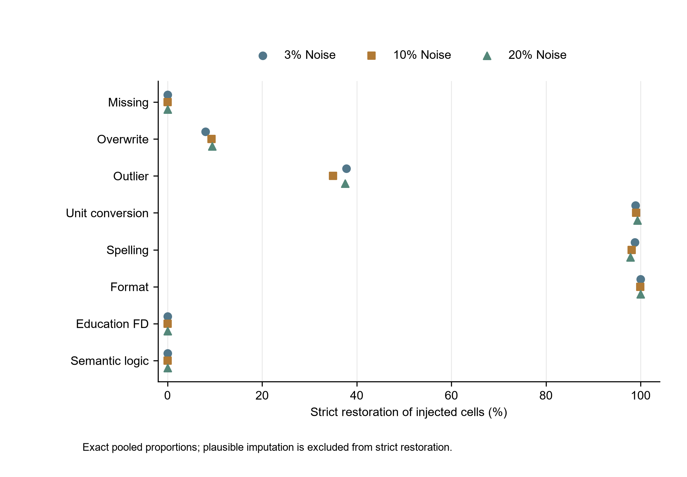

# 本次独立验收修复前后对比

数据是本次真正独立的五组×1600官方Adult测试记录，含1186条原生缺失记录。每档使用同一8000条身份，跨噪声档并非24000条全新样本。表中各档为五组累计，清洗处理14预测字段；income独立保留，不进入任何修复输入。

## 原始、注入、修复状态

original指未做本次人工注入的原始基准，仍含原生缺失，并非所有字段都已知完整正确。dirty由原生成器注入；J为冻结单次自动修复。检测指标是训练参考/规则告警，可能含合法长尾和语义例外，不当作真实错误标签。各告警类别可重叠，不能相加当总异常数。

|噪声等级|数据状态|缺失单元|检测告警单元|拼写告警|格式告警|量纲候选|跨字段告警|自动修改|待复核|
|---|---|---|---|---|---|---|---|---|---|
|3%|J|2379|4853|0|0|0|941|1683|4846|
|3%|dirty|2379|6529|570|563|363|934|0|0|
|3%|original|2139|3417|0|0|0|4|0|0|
|10%|J|2933|7993|0|0|0|2938|5436|7938|
|10%|dirty|2933|13374|1861|1849|1137|2844|0|0|
|10%|original|2139|3417|0|0|0|4|0|0|
|20%|J|3712|11461|0|0|0|4945|10511|11341|
|20%|dirty|3712|21851|3674|3501|2153|4566|0|0|
|20%|original|2139|3417|0|0|0|4|0|0|

前两状态没有提交修复/人工决定，动作数为0不表示没有问题；J的manual_review是待人工清单，未冒充已经人工完成。处理后再次扫描仅做量化，不执行第二轮修复。源标称3%/10%/20%沿用旧注入配额；因跳过零值×1000、已占用字段等，实际注入量以CSV为准，未为达标改配额或删样本。

## 严格恢复与合理近似

下表precision、restoration为百分比，数量按净变化单元计数。自动精确率=修改后严格等于原值/全部净修改；严格还原率=严格恢复注入单元/全部注入单元。reasonable_only只表示非原值但符合训练字段类型/范围的近似，仍计入wrong_modified，不计严格成功。不能把分类器内SimpleImputer结果计作流水线恢复。

|噪声等级|自动修改数|严格原值还原数|合理近似数|自动精确率/%|严格还原率/%|清洁误修数|待复核数|
|---|---|---|---|---|---|---|---|
|3%|1683|1605|78|95.3654|53.9496|0|4846|
|10%|5436|5180|256|95.2907|54.1954|0|7938|
|20%|10511|9981|530|94.9577|55.7785|0|11341|

J保留缺失及其原始标记，因此缺失数量不会像填补策略那样减少；fnlwgt低支持覆盖值可能继续越界并进入复核。逻辑/合法教育数字冲突无法判断哪一侧污染时保留。约95%修改精确率和零清洁单元误修不意味着全面恢复原始数据，复核量及剩余错误不能省略。

## 注入错误的离线残余

真值仅由独立离线量化程序使用；未进入实际修复。类型range为原覆盖注入，unit为原量纲注入。完整分组明细在各错误类型修复统计.csv。

|rate|type|injected|detected|modified|strict_restored|remaining_injected_errors|reasonable_only|wrong_modified|
|---|---|---|---|---|---|---|---|---|
|3%|fd|575|575|0|0|575|0|0|
|3%|format|563|563|563|563|0|0|0|
|3%|logic|179|179|0|0|179|0|0|
|3%|missing|240|240|0|0|240|0|0|
|3%|outlier|238|228|96|90|148|6|6|
|3%|range|236|236|87|19|217|68|68|
|3%|typo|577|577|570|570|7|0|0|
|3%|unit|367|367|367|363|4|4|4|
|10%|fd|1783|1781|0|0|1783|0|0|
|10%|format|1850|1850|1849|1849|1|0|0|
|10%|logic|565|565|0|0|565|0|0|
|10%|missing|794|794|0|0|794|0|0|
|10%|outlier|746|713|276|261|485|15|15|
|10%|range|775|775|303|72|703|231|231|
|10%|typo|1897|1897|1861|1861|36|0|0|
|10%|unit|1148|1148|1147|1137|11|10|10|
|20%|fd|3135|3128|0|0|3135|0|0|
|20%|format|3501|3501|3501|3501|0|0|0|
|20%|logic|877|877|0|0|877|0|0|
|20%|missing|1573|1573|0|0|1573|0|0|
|20%|outlier|1353|1295|537|508|845|29|29|
|20%|range|1532|1532|632|145|1387|487|487|
|20%|typo|3756|3756|3674|3674|82|0|0|
|20%|unit|2167|2167|2167|2153|14|14|14|

本次中噪声F1增益仍仅2.8820421159908305pp，低于3。数据质量诊断没有被用来在测试后修改J或再次评分。
