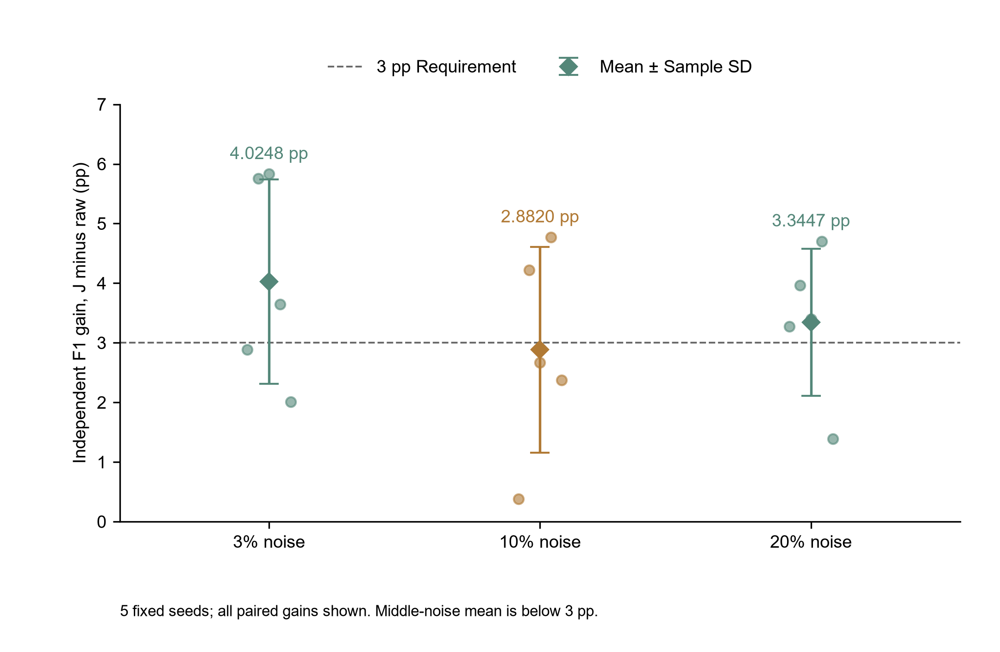

# 冻结后的独立F1验收

唯一正式标准：每档五次配对增益均值≥3个百分点，三档分别满足；不用CI下限、修复精确率90%、总体均值或挑选单次结果替代。第三阶段额外稳定性门槛不参与本次验收。

|噪声等级|gain_20260601|gain_20260602|gain_20260603|gain_20260604|gain_20260605|平均增益/pp|样本标准差/pp|达到3pp|
|---|---|---|---|---|---|---|---|---|
|3%|2.887116|5.753472|5.831444|3.641991|2.009781|4.024761|1.714164|是|
|10%|0.382704|4.216347|2.666667|4.770127|2.374365|2.882042|1.724533|否|
|20%|3.272947|3.967562|3.394642|4.701862|1.386304|3.344663|1.232153|是|

中噪声未达标，差值为3−2.8820421159908305=0.1179578840091695个百分点。不能通过四舍五入变为达标，最终F1验收不通过。

每组1600行，5组互不重叠，合计8000唯一记录；相同五组复用于3档，训练样本跨种子也可能重叠，不能称为15份互斥独立样本。分组早于J开发固定，未看income重采样。1186条含原生缺失；特征仅曾做资格排重/覆盖扫描，历史训练、选模、调参、旧测试身份交集为0，详见独立数据审计报告。

训练采用原3520/880各自固定注入再拼为4400，参考3400独立。每版本同3折内层、C={0.1,1,10}×权重={None,balanced}的18次预算，选训练内平均F1，精确平局取首个，选定后拟合全部4400。保持StandardScaler、原缺失标记流程、LBFGS1000轮及0.5阈值。训练/验证拟合填补、编码、标准化，不使用任何测试标签。所有1890内层及105最终拟合收敛。全部105套预测先冻结，之后一次读取5个封存标签文件评分；评价完成标记禁止再次独立评分。

每次ΔF1=(F1_J−F1_raw)×100，先算全精度配对差，再求均值和ddof=1样本SD。Accuracy、Precision、Recall、F1、AUC及全部基准在independent_runs.csv和全部基准同步重测.csv；五次细节如下。

|seed|rate|n|raw_accuracy|raw_precision|raw_recall|raw_f1|raw_auc|J_accuracy|J_precision|J_recall|J_f1|J_auc|gain_pp|
|---|---|---|---|---|---|---|---|---|---|---|---|---|---|
|20260601|3%|1600|0.782500|0.507909|0.809524|0.624190|0.865316|0.808750|0.548571|0.806723|0.653061|0.891705|2.887116|
|20260602|3%|1600|0.775625|0.508897|0.775068|0.614393|0.873184|0.818125|0.575290|0.807588|0.671928|0.898472|5.753472|
|20260603|3%|1600|0.756875|0.501656|0.774936|0.609045|0.857097|0.800000|0.562172|0.820972|0.667360|0.895255|5.831444|
|20260604|3%|1600|0.768750|0.496587|0.795082|0.611345|0.859143|0.798125|0.539020|0.811475|0.647764|0.899206|3.641991|
|20260605|3%|1600|0.795000|0.512733|0.880466|0.648069|0.903250|0.815625|0.543956|0.865889|0.668166|0.913235|2.009781|
|20260601|10%|1600|0.791250|0.520572|0.815126|0.635371|0.869028|0.797500|0.530499|0.803922|0.639198|0.886488|0.382704|
|20260602|10%|1600|0.776875|0.510381|0.799458|0.623020|0.866418|0.811875|0.564151|0.810298|0.665184|0.897985|4.216347|
|20260603|10%|1600|0.780625|0.534247|0.797954|0.640000|0.862955|0.798125|0.558824|0.826087|0.666667|0.894667|2.666667|
|20260604|10%|1600|0.753125|0.476268|0.795082|0.595701|0.858610|0.795625|0.535390|0.806011|0.643402|0.894302|4.770127|
|20260605|10%|1600|0.792500|0.509499|0.860058|0.639913|0.895721|0.813750|0.541436|0.857143|0.663657|0.906051|2.374365|
|20260601|20%|1600|0.773750|0.495430|0.759104|0.599558|0.854671|0.795000|0.527103|0.789916|0.632287|0.880994|3.272947|
|20260602|20%|1600|0.765625|0.494898|0.788618|0.608150|0.856058|0.797500|0.540835|0.807588|0.647826|0.893243|3.967562|
|20260603|20%|1600|0.770000|0.519525|0.782609|0.624490|0.847637|0.792500|0.550775|0.818414|0.658436|0.885862|3.394642|
|20260604|20%|1600|0.758125|0.482234|0.778689|0.595611|0.857496|0.789375|0.525130|0.827869|0.642630|0.893888|4.701862|
|20260605|20%|1600|0.798750|0.518650|0.851312|0.644592|0.894364|0.809375|0.534545|0.857143|0.658455|0.906993|1.386304|

新总体包含自然缺失，不能将旧外部2.943或第三阶段开发CV与此直接作算法因果差分。同步基准只用于描述，不允许测试后改选另一版本宣布J通过。

